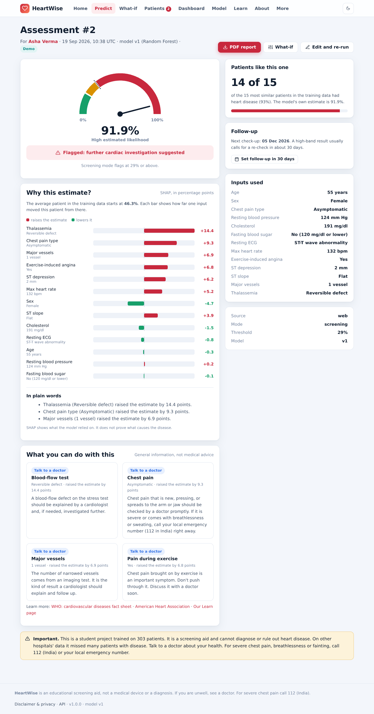
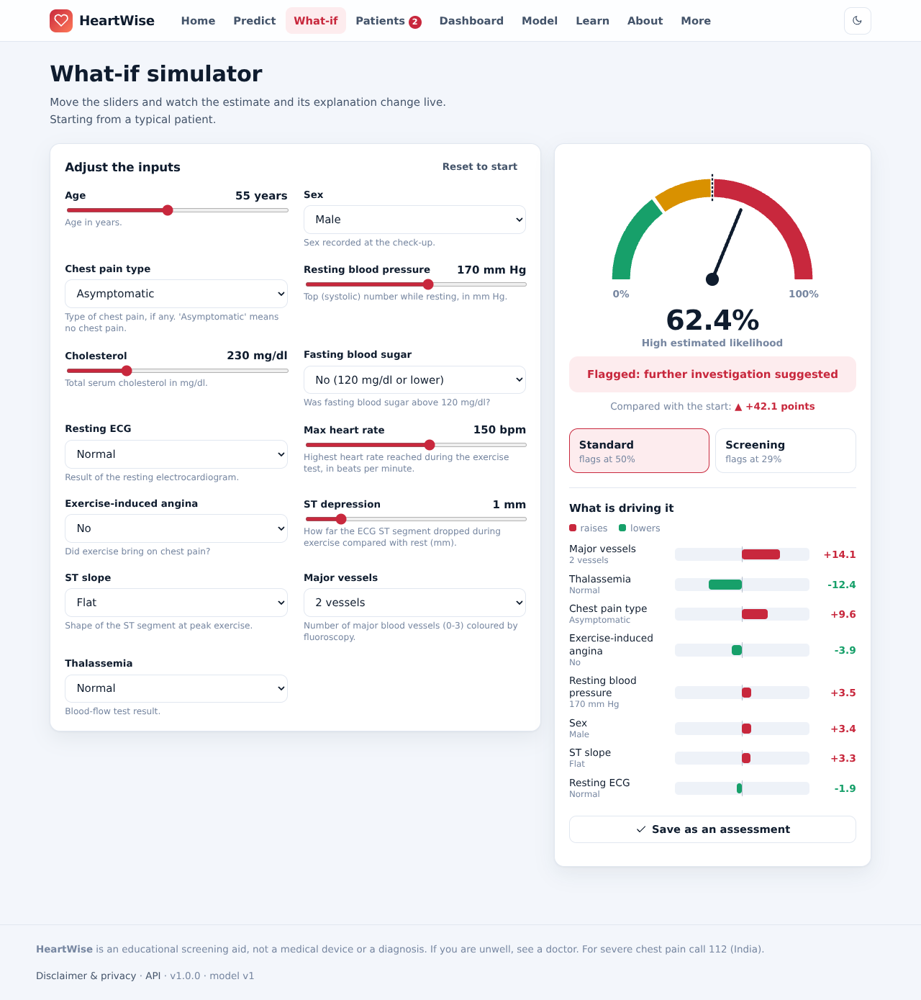
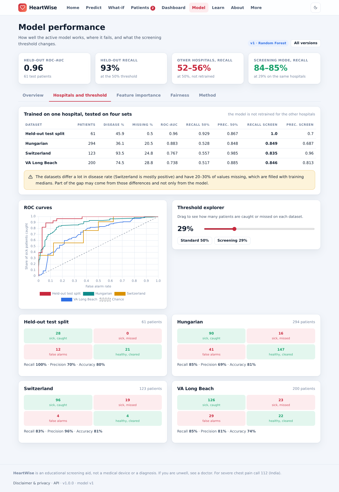
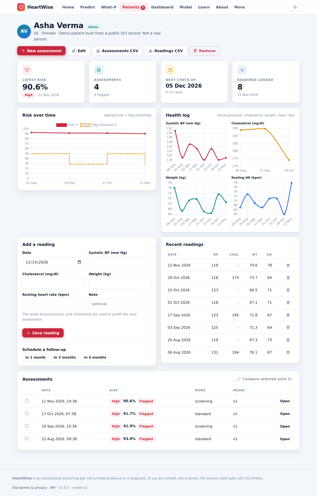
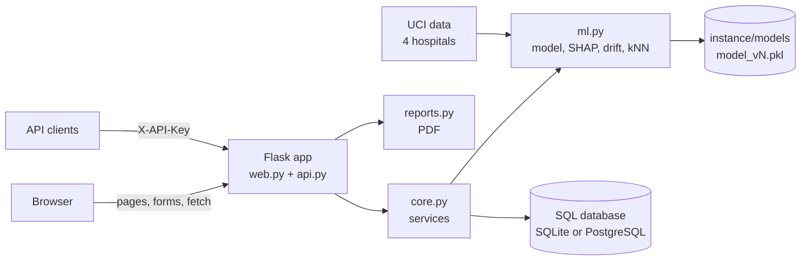

# HeartWise

An explainable heart-disease screening web app. Enter 13 routine check-up measurements and get an estimate of the likelihood of heart disease, **a breakdown of why** (SHAP), and honest information about where the model stops being reliable. Around the model there is a full application: patients, health logs, history, PDF reports, a REST API, batch scoring, dashboards, model versions and drift monitoring.

> **Educational screening aid, not a medical device.** Trained on 303 patients from one hospital. Never use it to diagnose or rule out heart disease.

| | |
|---|---|
|  |  |
| Estimate with SHAP explanation | What-if simulator (live) |
|  |  |
| Cross-hospital validation + threshold explorer | Patient record, health log, trends |

More screenshots are in [`docs/screenshots/`](docs/screenshots).

## What is in it

**Pages:** Home, Predict, What-if, Patients (list, detail, edit), History, Compare, Batch scoring, Dashboard, Model performance, Learn, About, Disclaimer, API docs, Admin (overview, models, system).

| Area | Features |
|---|---|
| Prediction | Random Forest estimate, risk bands, **standard and screening modes**, input validation, out-of-range warnings |
| Explainability | **SHAP** breakdown in percentage points (adds up exactly to the estimate), plain-language sentences, advice cards, "patients like this one" (nearest neighbours) |
| What-if | Sliders that re-score live and show the change against the starting values |
| Patients | Records with soft delete, search and filters, pagination, health log (blood pressure, cholesterol, weight, heart rate) with trend charts, follow-up reminders (dashboard and nav badge) |
| History | Every assessment from web, API and batch; compare any two side by side; CSV export |
| Reports | One-page **PDF report** per assessment, CSV exports, batch CSV scoring (up to 500 rows) |
| Model transparency | Model comparison, ROC curves for four datasets, **threshold explorer** with confusion matrices, feature importance, **fairness by sex and age**, method notes |
| Operations | **Drift monitoring**, model versions, **retrain from an uploaded CSV** and switch versions, audit log, JSON request logs, `/health` |
| API | `/api/predict`, `/explain`, `/batch`, `/model`, `/assessments`, `/health`; API keys (stored hashed), rate limit per key, generated **docs page** and `openapi.json` |
| Security | CSRF tokens on every form, security headers, validated inputs, output escaping, read-only admin mode for public deployments |
| Engineering | 61 pytest tests, GitHub Actions CI, Dockerfile and compose, config through environment variables |

**Deliberately left out:** sign-up, login, logout, password reset and user roles (by request; see "Security notes"), e-mail reminders (they need an SMTP account; reminders appear in-app), Hindi translation.

## Quick start

Needs **Python 3.12**. On Windows you can double-click `run_windows.bat`. Or by hand:

```bash
python -m venv venv
venv\Scripts\activate            # Mac/Linux: source venv/bin/activate
pip install -r requirements.txt
python app.py
```

Open <http://127.0.0.1:5000>. **The first start trains the model** (10 to 60 seconds) and loads 8 fictional demo patients so every page has something to show. Later starts take a couple of seconds.

### Useful commands

```bash
python manage.py init                # create tables, train the first model, load demo data (safe to repeat)
python manage.py demo / clear-demo   # add or remove the demo patients
python manage.py train my.csv        # train a new model version from a labelled CSV (not activated automatically)
python manage.py create-key "name"   # print a new API key (shown once)
python -m pytest tests -q            # run the tests  (pip install -r requirements-dev.txt first)
```

### Settings (environment variables)

| Variable | Default | Meaning |
|---|---|---|
| `SECRET_KEY` | generated into `instance/secret_key` | Signs sessions and CSRF tokens. Set it explicitly in production |
| `DATABASE_URL` | SQLite in `instance/heart.db` | Any SQLAlchemy URL. For PostgreSQL also `pip install psycopg2-binary` |
| `INSTANCE_DIR` | `./instance` | Where the database, models, uploads and secret key live |
| `READ_ONLY_ADMIN` | `0` | `1` blocks retraining, model switching, API keys and demo-data changes |
| `LOAD_DEMO` | `1` | Load demo patients on first run |
| `API_RATE_LIMIT` | `30` | Requests per minute per API key |
| `HOST`, `PORT` | `127.0.0.1`, `5000` | For `python app.py` |

## How it works



1. **Data:** the four UCI Heart Disease files in `data/`. Cleveland (303 patients) trains the model; Hungarian, Switzerland and VA Long Beach are used only to test it.
2. **Training (`ml.train_model`):** clean, impute with the median, compare four models with 5-fold cross-validation, keep the best tree-based model (SHAP's exact explainer needs one), choose the screening threshold, compute SHAP importance, score all four datasets and the fairness groups.
3. **Serving:** each version is saved as `instance/models/model_vN.pkl` and recorded in the database. Every assessment remembers which version made it.
4. **Screening threshold:** the highest threshold that still catches 90% of true cases in cross-validated predictions on the training data. It exists because validation showed the standard 50% threshold missed about half of the patients with disease at other hospitals.

### Project layout

```
app.py          application factory, CSRF, headers, error pages, JSON logging, `python app.py`
config.py       settings from environment variables
models.py       database tables (Patient, HealthLog, Assessment, ModelVersion, ApiKey, AuditLog)
ml.py           data loading, training, SHAP, drift, similar patients (no Flask inside)
core.py         services: load models, analyse, save assessments, audit trail
web.py          all browser pages          api.py   REST API + registry that generates the docs
reports.py      PDF report                 advice.py plain-language sentences and advice cards
seed.py         fictional demo patients    manage.py command-line helpers
templates/      Jinja pages                static/  CSS, JavaScript, bundled Chart.js (no CDN needed)
data/           four UCI files             tests/   61 tests
```

## API

Create a key on **Admin > System** (or `python manage.py create-key name`), then:

```bash
curl -X POST http://127.0.0.1:5000/api/explain ^
  -H "X-API-Key: hw_YOUR_KEY" -H "Content-Type: application/json" ^
  -d "{\"age\":67,\"sex\":1,\"cp\":4,\"trestbps\":160,\"chol\":286,\"fbs\":0,\"restecg\":2,\"thalach\":108,\"exang\":1,\"oldpeak\":1.5,\"slope\":2,\"ca\":3,\"thal\":3}"
```

(`^` continues a line in Windows cmd; use `\` on Mac/Linux.) Full, interactive documentation with a "Try it" button is at `/docs`; the OpenAPI file is at `/api/openapi.json`. Errors are JSON: `{"error": {"code": "...", "message": "..."}}`. Over the rate limit you get `429` and a `Retry-After` header.

## Deployment

**Docker:** `docker compose up --build`, then open <http://localhost:8000>. Data, models and the secret key are kept in the `heartwise-data` volume. The first start trains the model, so allow a minute or two. *The Docker files were written but could not be run in the environment this project was built in; the same start command was tested directly with gunicorn.*

**Render, Railway or similar:** build with `pip install -r requirements.txt gunicorn`; start with `python manage.py init && gunicorn -w 2 -b 0.0.0.0:$PORT --timeout 300 "app:create_app()"`. Set `SECRET_KEY`, `READ_ONLY_ADMIN=1`, attach a persistent disk and set `INSTANCE_DIR` to it. Free plans without a disk lose data on restart, which is fine for a demo because demo data is rebuilt.

## Security notes

- **There is no login in this version.** Anyone who can open the site sees everything and can add or delete patients. Do not enter real personal or health data on a public deployment, and set `READ_ONLY_ADMIN=1` so strangers cannot retrain the model or create API keys. Put real authentication in front of it before any real use.
- Implemented: CSRF tokens, hashed API keys, per-key rate limits, input validation, escaping of all user text, security headers, an audit log.
- Not implemented: HTTPS (terminate it at your host or proxy), account lockout, encryption of data at rest.

## Honest limitations

- 303 training patients from one hospital in the 1980s, few of them women. The held-out test set has 61 patients, so single scores can move several points with a different split.
- On the three other hospitals the model ranks patients reasonably (ROC-AUC about 0.74 to 0.88) but at the standard 50% threshold it catches only about 52 to 56% of patients with disease. Screening mode raises that to about 84 to 85%, at the cost of more false alarms. Those datasets also have 20 to 30% missing values and very different disease rates, so part of the gap may come from the data and not the model.
- SHAP explains what the model used, not what causes disease. Nothing here is clinically validated.
- The Hungarian file in this repository starts with a header line instead of data; the cleaning step drops it, leaving the documented 294 patients.

## Credits and licenses

- Data: UCI Machine Learning Repository, Heart Disease dataset. Creators: Andras Janosi (Hungarian Institute of Cardiology), William Steinbrunn (University Hospital Zurich), Matthias Pfisterer (University Hospital Basel), Robert Detrano (V.A. Medical Center, Long Beach and Cleveland Clinic Foundation). Please cite the dataset from its UCI page.
- [Chart.js](https://www.chartjs.org/) (MIT) is bundled in `static/js`. Other libraries: Flask, SQLAlchemy, scikit-learn, XGBoost, SHAP, pandas, ReportLab.
- Background: El-Sofany et al., *Scientific Reports* 14, 23277 (2024); Lundberg and Lee, *A Unified Approach to Interpreting Model Predictions*, NeurIPS 2017.
- This repository has no license file yet. Choose one (MIT is a common choice) before publishing it.
